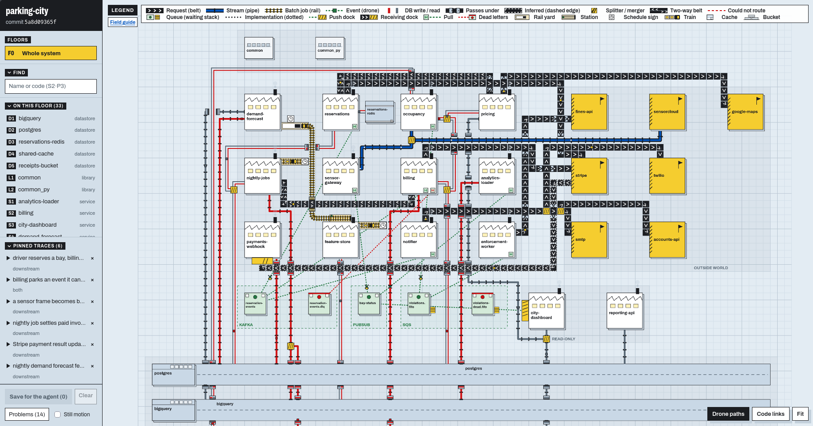
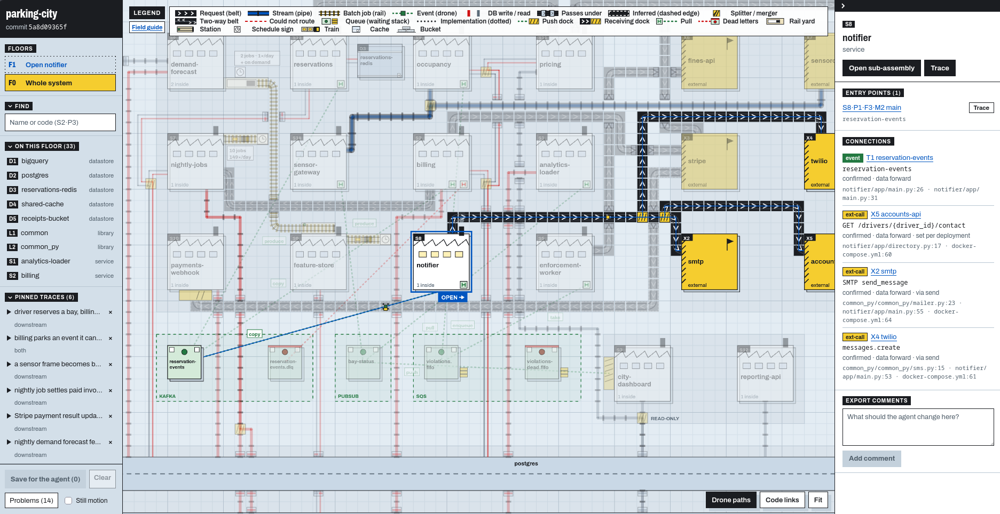
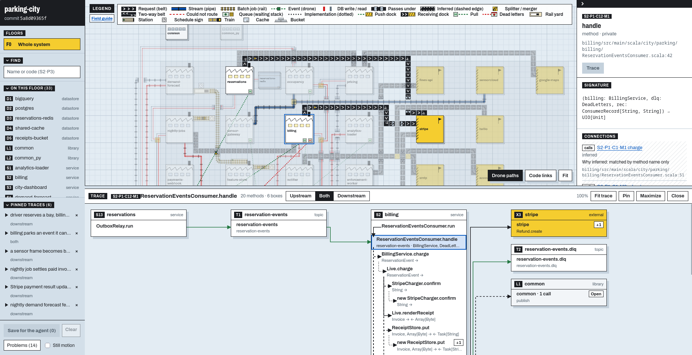
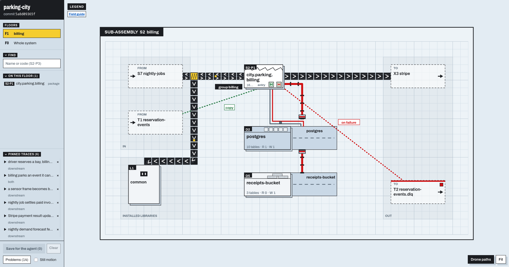

# codebase-map

**Turn a repository into a map you can walk through:** its services, the calls between them, events, streams and
database reads and writes, drawn as a factory floor of buildings and belts.

**[Open the demo](https://si1verwind17.github.io/codebase-map/demo/)** · **[Read the field guide](https://si1verwind17.github.io/codebase-map/)** · [Install](#install)

`codebase-map` is an agent skill. You ask your coding agent to map a repository, it reads the code, and you get an
interactive page you can open in any browser. It works with Claude Code, GitHub Copilot, Cursor, Codex, Antigravity
CLI and any other agent that reads [Agent Skills](https://agentskills.io).

<table>
  <tr>
    <td width="50%" align="center" valign="top"><a href="docs/images/site.png"></a><br><p align="left"><b>See the whole system.</b> Services are buildings, databases a bus along the bottom; belts, pipes, drones and rails are requests, streams, events and batch jobs.</p></td>
    <td width="50%" align="center" valign="top"><a href="docs/images/selected.png"></a><br><p align="left"><b>Click anything.</b> Every connection names the file and line it comes from, and whether it was seen or inferred.</p></td>
  </tr>
  <tr>
    <td width="50%" align="center" valign="top"><a href="docs/images/trace.png"></a><br><p align="left"><b>Follow the data.</b> Trace any box upstream or downstream to the methods, tables, topics and services it reaches, with example requests.</p></td>
    <td width="50%" align="center" valign="top"><a href="docs/images/inside.png"></a><br><p align="left"><b>Go inside.</b> Open a service to see its packages, classes and methods on floors of their own.</p></td>
  </tr>
</table>

**Keep it current.** A map records the commit it was made from, and asking again rescans only what changed.
Comments and pins you leave in the viewer go back to the agent on the next run.

## Install

**Claude Code**

```
/plugin marketplace add si1verwind17/codebase-map
/plugin install codebase-map@codebase-map
```

**GitHub Copilot, Cursor, Codex, Antigravity CLI and others,** via GitHub CLI:

```
gh skill install si1verwind17/codebase-map
```

**Anything else:** copy [`skills/visualizing-codebases/`](skills/visualizing-codebases/) into your agent's skills
folder.

You need Python 3.10 or later and git. Node 18 or later is optional: with it, each run also checks the drawing.

## Use

In the repository you want mapped, run the skill by name:

```
/codebase-map:visualizing-codebases
```

That is its name when installed as the Claude Code plugin; copied into a skills folder it is
`/visualizing-codebases`. Or just ask your agent in plain words:

> Map this repository.

Later, run it again, or ask:

> Refresh the code map for the latest commit.

The map lands in `docs/viz-code/`. Open `docs/viz-code/index.html`, and commit `code-map.json`, `stack.yaml` and
`README.md` from that folder; the rest are working files, already gitignored.

**Found something it gets wrong?** Run the skill with `send-feedback`
(`/codebase-map:visualizing-codebases send-feedback`), or ask your agent to send feedback on the code map. It drafts
an issue for this repository with your code's names left out, shows you the exact text, and opens GitHub's form; you
read it and submit it yourself. Or [open an issue](https://github.com/si1verwind17/codebase-map/issues/new/choose)
directly.

**Languages:** Scala, Python, Java, Kotlin, TypeScript, JavaScript, Go, C#, Rust, Ruby and PHP. A generic reader
maps classes, methods, calls and imports in any of them, whatever the framework. Common frameworks' routes and
libraries are known out of the box (Spring, NestJS, Express, FastAPI, Rails, Laravel, ASP.NET, Axum and more); for
any other, the agent works them out from your code and records them in a `stack.yaml` next to the map.

## Development

How the repo is laid out and how to build and test it: [DEVELOPMENT.md](DEVELOPMENT.md).

## License

[MIT](LICENSE)
